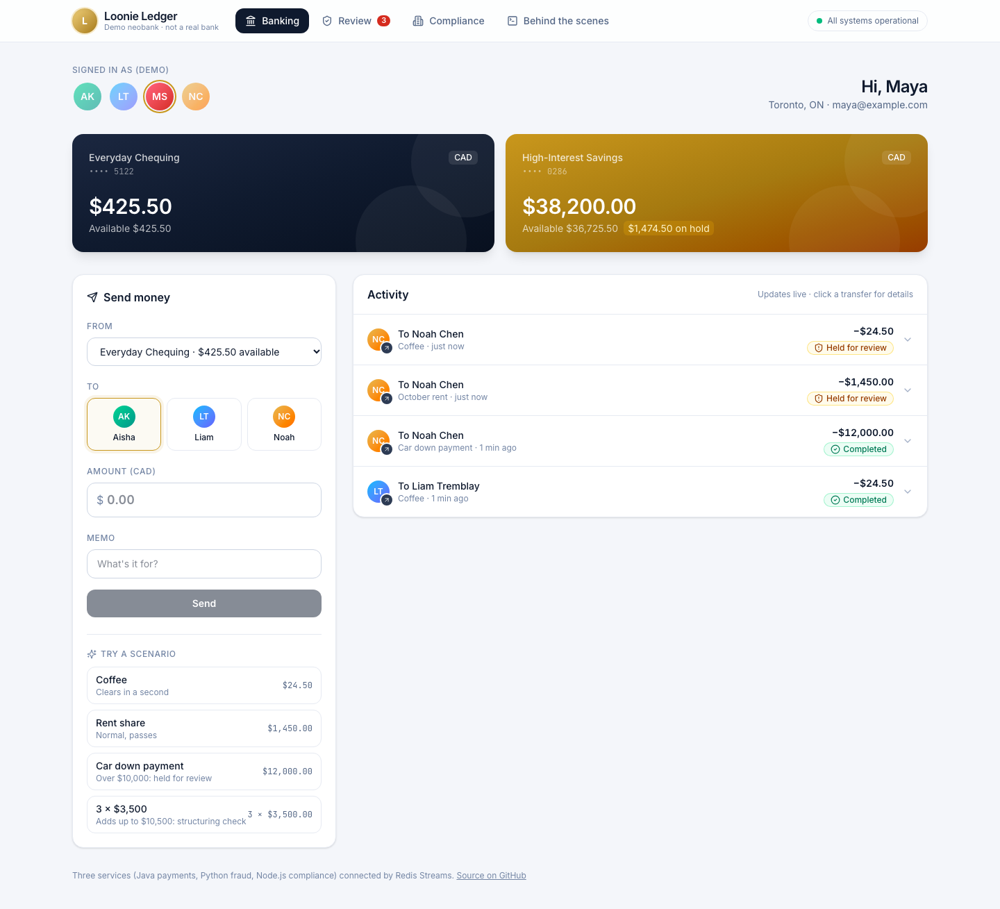
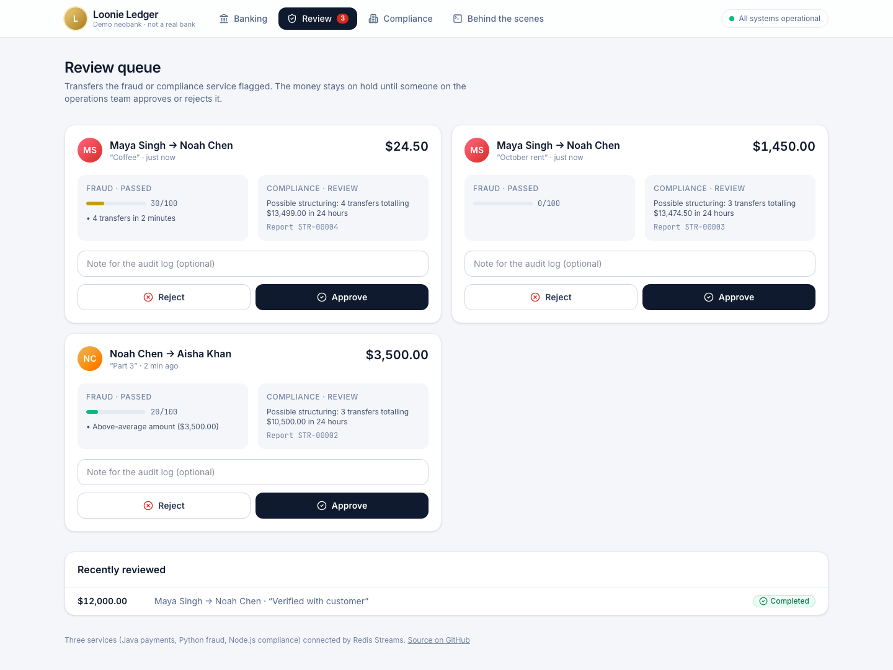
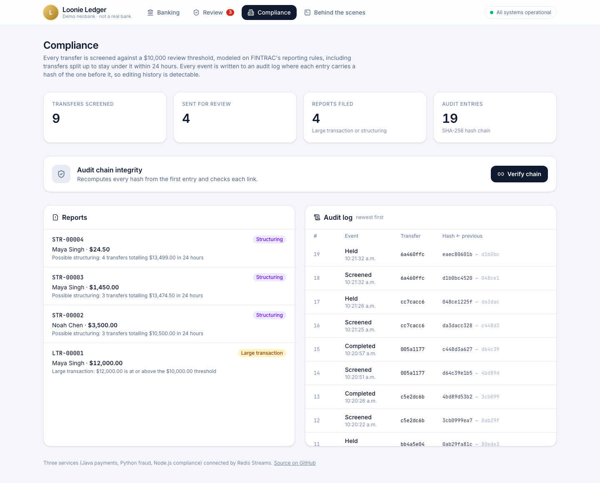
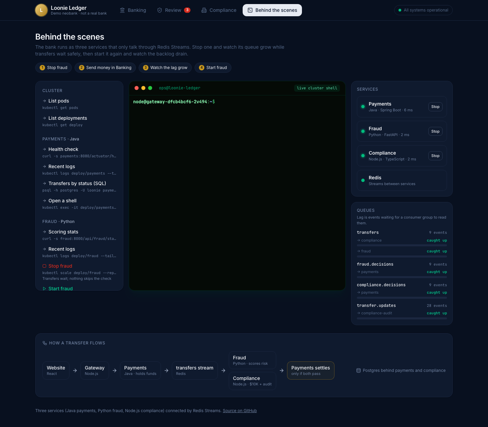

# Loonie Ledger

A demo Canadian neobank built from three microservices in three languages, plus
a **Behind the scenes** console where you can run `kubectl`, `redis-cli` and
`psql` against the running system, stop services, and exec into pods.

Customers send money to each other. Every transfer is checked by a **fraud**
service and a **compliance** service before any money moves. If either one
flags it, the funds stay on hold until someone on the operations team approves
or rejects it.

> Not a real bank. The compliance rules are modeled on Canada's FINTRAC $10,000
> reporting threshold for demonstration only.



| Review queue | Compliance | Behind the scenes |
| --- | --- | --- |
|  |  |  |

## The three services

| Service | Language | Owns | What it does |
| --- | --- | --- | --- |
| [payments](services/payments) | Java 21, Spring Boot | Postgres `payments` | Accounts, transfers, double-entry ledger, holds, review decisions |
| [fraud](services/fraud) | Python 3.13, FastAPI | Redis keys `fraud:*` | Scores each transfer with explainable rules; holds anything scoring 60+ |
| [compliance](services/compliance) | Node.js 22, TypeScript | Postgres `compliance` | $10,000 large-transaction reviews, 24-hour structuring checks, hash-chained audit log |

A fourth component, the [gateway](services/gateway), serves the React website,
proxies the APIs, streams live updates to the browser, and runs the ops terminal.

## How a transfer flows

```
 Browser ─► gateway ─► payments ── holds the funds, writes TransferRequested to its outbox
                          │
                          ▼  (outbox relay)
                    Redis stream "transfers"
                     │                     │
            group "fraud"           group "compliance"
                     ▼                     ▼
              fraud (Python)        compliance (Node.js)
           scores 0-100, reasons    $10K + 24-hour checks, audit log
                     │                     │
         "fraud.decisions"       "compliance.decisions"
                     └──────────┬──────────┘
                                ▼
           payments settles: both PASS/CLEAR → money moves
                             either flags it → HELD for review
```

The services never call each other. They only exchange events, so any one of
them can be down without the others failing.

### What's guaranteed, and how

- **No money moves unchecked.** Payments settles a transfer only when it has
  both verdicts. If fraud or compliance is down, transfers wait with the funds
  held, and complete once the service comes back. The smoke test checks this.
- **No lost events.** Payments uses a **transactional outbox**: an event is
  written in the same Postgres transaction as the change it describes, then
  relayed to Redis. If Redis is down, events wait in Postgres.
- **At-least-once delivery, exactly-once effects.** Consumers use **Redis
  Streams consumer groups** and acknowledge a message only after handling it. A
  crashed consumer's messages are delivered again, and another replica claims
  them after 15 seconds (`XAUTOCLAIM`). Every handler is idempotent: a repeated
  verdict is ignored, and a repeated transfer gets the stored decision back.
- **No overdrafts or double spends.** Account rows are locked (`SELECT ... FOR
  UPDATE`) while funds are held or settled, always in the same order, so two
  opposite transfers can't deadlock. A double-entry ledger records both legs of
  every transfer.
- **Tamper-evident audit log.** Each audit entry stores the SHA-256 hash of the
  previous one. Editing or deleting any past entry breaks the chain at that
  point, and **Verify chain** shows exactly where.

### The fraud rules

| Rule | Points |
| --- | --- |
| First transfer to this recipient | 20 |
| $10,000 or more (20 points from $3,000) | 40 |
| More than 3× the sender's average, after 3+ transfers | 30 |
| 3 or more transfers in the last 2 minutes | 30 |
| Round thousands | 10 |
| Sent between midnight and 5 AM Toronto time | 10 |

A score of 60 or more holds the transfer. Every rule that fires adds a
plain-English reason, such as "First transfer to Liam" or "4.2x this
customer's average transfer", which shows up for the reviewer.

## Run it

### Option 1: one command, with Docker or Podman Compose

```sh
docker compose up --build        # or: podman compose up --build
```

Open <http://localhost:8080>. Set `GATEWAY_PORT=8088` if 8080 is taken. The
terminal runs in **demo mode** here: commands run against the live services,
and "scaling a service to 0" pauses its event consumer.

### Option 2: Kubernetes, with a real terminal

On Kubernetes, the terminal is a real `bash` shell inside the gateway pod, with
`kubectl`, `redis-cli`, `psql` and `curl`. Its service account can only manage
pods and deployments in the `loonie` namespace. You need
[kind](https://kind.sigs.k8s.io/), `kubectl`, and Docker or Podman.

```sh
export KUBECONFIG=$PWD/kind.kubeconfig     # keeps this away from your other clusters
kind create cluster --name loonie

# Build the four images (Docker shown; for Podman see below)
for s in payments fraud compliance gateway; do
  docker build -t loonie-$s:dev services/$s
  kind load docker-image loonie-$s:dev --name loonie
done

kubectl apply -f deploy/k8s/loonie-ledger.yaml
kubectl -n loonie rollout status deploy/gateway
kubectl -n loonie port-forward svc/gateway 8080:8080
```

Open <http://localhost:8080/#ops> and try `kubectl scale deploy/fraud
--replicas=0`, then send money, then scale it back to 1.

**With Podman:** run `export KIND_EXPERIMENTAL_PROVIDER=podman` first, and build
each image as `docker.io/library/loonie-$s:dev`. Podman would otherwise name it
`localhost/...`, and Kubernetes wouldn't find it. Then load all four with
`podman save -o images.tar <the four image names>` and
`kind load image-archive images.tar --name loonie`.

Clean up with `kind delete cluster --name loonie`.

## Try it

1. **Banking:** use the scenario buttons.
   - **Coffee** clears in about a second.
   - **Car down payment** ($12,000) is held. Fraud scores it 70, and compliance
     files a large-transaction report.
   - **3 × $3,500** gets the third transfer held for possible structuring.
2. **Review:** approve or reject held transfers. The note goes into the audit
   log.
3. **Compliance:** see the reports, then click **Verify chain**.
4. **Behind the scenes:** stop fraud, send money, and watch `transfers → fraud`
   lag grow while the transfer waits. Then start fraud and watch it drain.

## Tests

```sh
cd services/payments   && ./gradlew test          # needs Docker or Podman: runs against real Postgres and Redis
cd services/fraud      && python -m pytest        # scoring rules
cd services/compliance && npm test                # screening rules and hash-chain tamper detection
cd services/gateway    && npm test                # demo-terminal safety (blocks unknown commands and hosts)
scripts/smoke.sh http://localhost:8080            # end to end, against a running stack
```

`smoke.sh` runs these checks:
- A clean transfer settles.
- A $12,000 transfer is held and then approved.
- Structuring is caught.
- A transfer waits while fraud is stopped, then completes when it's back.
- The audit chain verifies.
- No money was created or destroyed across all accounts.

The payments tests use Testcontainers. With Podman, set
`DOCKER_HOST=unix://$(podman machine inspect --format '{{.ConnectionInfo.PodmanSocket.Path}}')`
and `TESTCONTAINERS_RYUK_DISABLED=true`.

## Things I learned building it

- **Pausing a consumer is a race.** A Redis read that's already blocking
  returns messages after you pause. The consumers now check the pause flag
  after each read and leave those messages unacknowledged, so they're
  redelivered on resume. The smoke test caught this.
- **Kubernetes service links.** A Service named `redis` makes Kubernetes inject
  `REDIS_PORT=tcp://10.96.x.x:6379` into every pod, which broke every service
  that reads `REDIS_PORT`. The pods set `enableServiceLinks: false`.

## Layout

```
services/payments     Java 21 · Spring Boot · Flyway · JdbcTemplate · Testcontainers
services/fraud        Python 3.13 · FastAPI · redis-py (asyncio)
services/compliance   Node.js 22 · TypeScript · Express · pg · ioredis
services/gateway      Node.js 22 · Express · ws · node-pty, plus web/ (React 19 · Vite · Tailwind · xterm.js)
deploy/k8s            Kubernetes manifests (StatefulSets for Postgres and Redis, RBAC for the ops terminal)
compose.yaml          The whole stack for Docker or Podman Compose
scripts/smoke.sh      End-to-end checks
```
